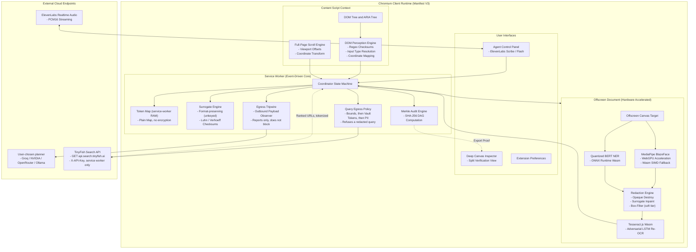
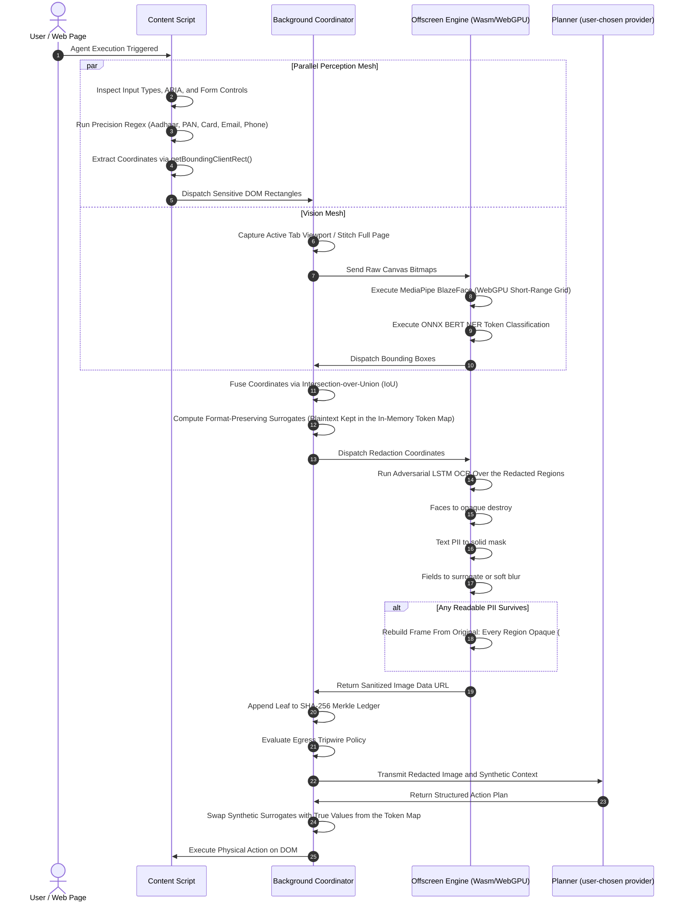
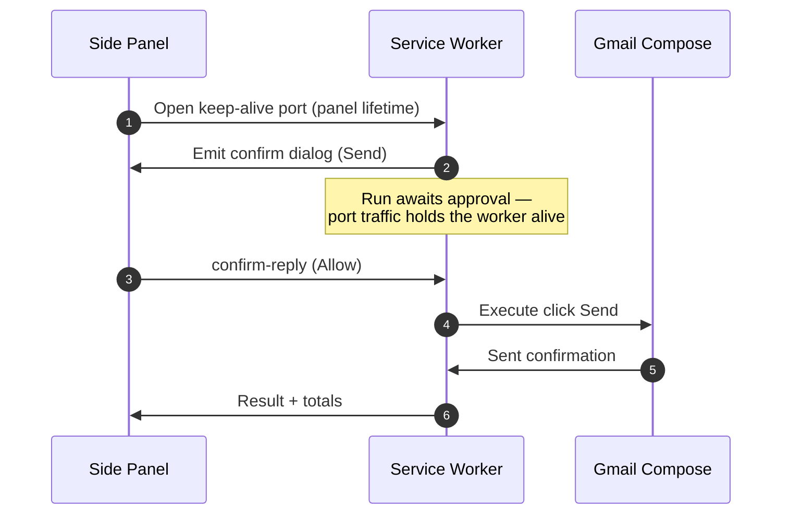
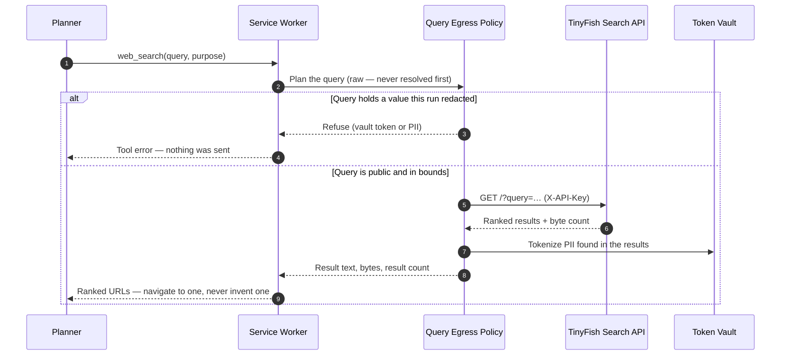
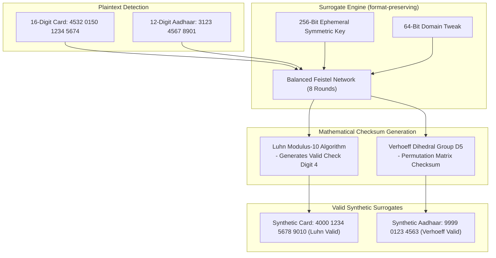
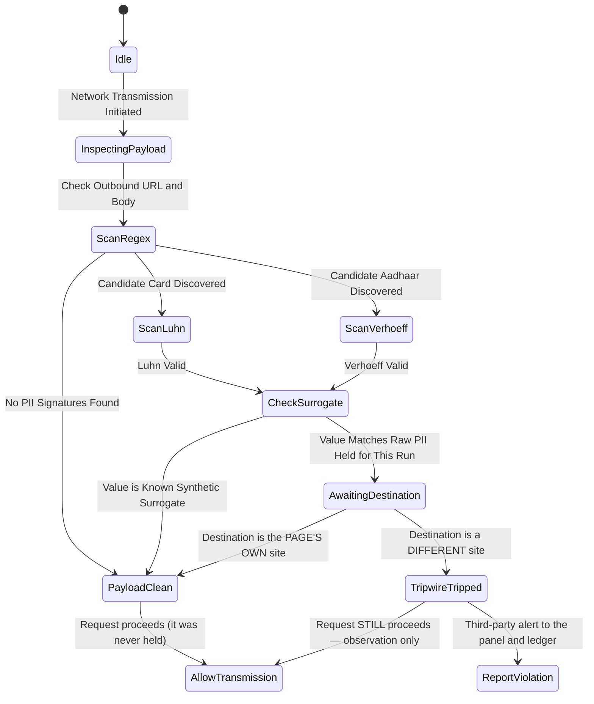

# PRY: On-Device Visual Perception and Privacy-Preserving Browser Agent

PRY is an autonomous, client-side browser agent for Chromium Manifest V3. It intercepts, sanitizes, and cryptographically certifies the redaction of personally identifiable information (PII) before any visual or textual state reaches external inference endpoints or trackers.

Developed for Smart India Hackathon 2026, Problem Statement 26171: *On-Device Visual Perception for Lightweight Browser Agents*.

---

## Table of Contents

- [1. Executive Summary](#1-executive-summary)
- [2. Problem Statement and Threat Model](#2-problem-statement-and-threat-model)
- [3. System Architecture and Process Isolation](#3-system-architecture-and-process-isolation)
- [4. Dual-Mesh Perception Engine](#4-dual-mesh-perception-engine)
- [5. Models, Planner Policy, and Learning](#5-models-planner-policy-and-learning)
  - [Optional web search (TinyFish)](#optional-web-search-tinyfish)
- [6. Mathematical and Cryptographic Specifications](#6-mathematical-and-cryptographic-specifications)
- [7. Outbound Egress Tripwire and Security Invariants](#7-outbound-egress-tripwire-and-security-invariants)
- [8. Inspector, Comparison, Repository](#8-inspector-comparison-repository)
- [9. Installation, Verification, and Build](#9-installation-verification-and-build)
- [10. Regulatory Alignment and License](#10-regulatory-alignment-and-license)

---

## 1. Executive Summary

Standard agents screenshot viewports, dump raw DOM trees, and ship both to cloud models — leaking faces, IDs, credentials, and session content into third-party traces. PRY draws the security boundary inside the client: on-device perception (DOM heuristics plus WebGPU/WebAssembly neural vision) redacts first, proves it, and only then transmits.

- **Redaction:** faces destroyed opaque (never blurred — blur is recoverable), across BlazeFace whole-frame + native tiles, Chrome shape detector, and a skin-colour pass. Guarantee: irreversibility of what is detected, not complete detection.
- **Surrogates:** format-preserving, checksum-valid (Luhn/Verhoeff) replacements so validation and reasoning survive the swap. Hash-derived, unkeyed — **not** NIST FF3-1 (§6.1).
- **Verification:** every redacted region re-read by local OCR from the exact shipped bytes; leaking frames rebuilt fully opaque. Proof covers redacted regions, not undiscovered PII.
- **Accountability:** tamper-evident SHA-256 ledger, exportable Merkle root (`audit-proof.json`).
- **Egress:** tripwire reports PII-shaped page sends by destination. **Reports; never blocks.**
- **Search (optional):** a TinyFish `web_search` tool resolves the target URL in one round trip. **Off until a key is set**, and a query containing a value this run already redacted is **refused, not resolved** — the one channel where a string has to stay readable is the one string a redaction cannot protect.

---

## 2. Problem Statement and Threat Model

A multimodal agent's screenshot + DOM payload routinely carries biometrics, visible Aadhaar/PAN/cards, and session content into provider telemetry or training pipelines. PRY defends four vectors:

- **Cloud eavesdropping/breach:** payloads hold only surrogates and zero-entropy masks — nothing to reconstruct.
- **De-blurring attacks:** no blur for biometrics; any soft region the OCR auditor can still read escalates to opaque pre-ship.
- **Brittle masking:** `[REDACTED]` breaks validation and reasoning; synthetically valid numbers don't.
- **Unverifiable compliance:** an immutable Merkle audit DAG instead of server logs.

Regulatory cover: India DPDP Act 2023 §6, GDPR Articles 9/25 (protection by design/default), HIPAA Privacy Rule.

The integration adds one surface **by choice, not by attack**: the optional TinyFish search channel (§5). It is off until the user supplies a key, and a query that holds a value this run redacted is refused rather than resolved — PRY's own outbound requests answer to the same disclosure standard as the page's.

---

## 3. System Architecture and Process Isolation

Strict Manifest V3 partitioning — isolated contexts for page, coordination, and pixel work:



- **Content scripts** inspect the DOM read-only in an Isolated World; page scripts cannot touch PRY state.
- **Service worker** coordinates tabs, surrogates, the in-memory token map, the Merkle tree, and tripwires.
- **Offscreen document** holds the DOM/Canvas access MV3 denies workers — all vision and OCR run here.
- No raw pixels persist (`chrome.storage` never holds images); token mappings live only in worker heap, cleared on teardown.

---

## 4. Dual-Mesh Perception Engine



- **Mesh 1 (DOM):** regex + checksum matching with viewport coordinates (transforms, DPR, scroll aware). Control names count as findable text — `find_text` sweeps placeholders, aria-labels, alts, tooltips and submit values (`Search [placeholder]`), so it agrees with field matching. Email addresses commit exactly: suggestions are clicked only on exact address match, strangers dismissed with Escape, committed with Tab, verified in the compose dialog.
- **Mesh 2 (pixels):** BlazeFace + BERT NER independent of DOM structure — obfuscated layouts and SVG text stay protected.
- **Fusion:** IoU reconciliation into envelope boxes (4 px margin) with PII class labels.

---

## 5. Models, Planner Policy, and Learning

All perceptual models run locally — zero inference data leaves the machine:

| Model | File | Role |
| :--- | :--- | :--- |
| BlazeFace short-range TFLite (224 KB) | `models/blazeface/` | Faces over WebGPU (`tasks-vision`), 4–9 ms/frame, WASM SIMD fallback |
| Quantized BERT NER Q8 (108 MB) | `models/ner/onnx/` | Names/orgs/locations via `onnxruntime-web`, inputs capped at 4 000 chars |
| Tesseract LSTM (WASM) | bundled | Adversarial auditor: crops regions from shipped bytes, rebuilds opaque on leaks |
| ElevenLabs Scribe / Flash v2.5 | API | 16 kHz mic input; TTS that speaks vault tokens as "redacted" (redact, never refuse) |

Mic needs the `audioCapture` manifest permission — without it the panel names the real cause instead of echoing Chrome's `NotFoundError`.

**Planner** (Groq/NVIDIA/OpenRouter/Anthropic/OpenAI/Ollama through one adapter; default `nvidia/nemotron-3.5-lightning-30b-a3b`): consumes tokenized text and post-redaction frames only. Turns are bounded by **silence, not wall clock**:

| Boundary | Budget | Catches |
| :--- | :--- | :--- |
| First output | 90 s (20 s retry) | No first token; retried once only for proven endpoints |
| Unacknowledged request | 25 s (60 s NVIDIA) | No headers — stall/queue; re-routes to fast model when one exists |
| Mid-turn silence | 30 s | Post-output drops (45 s+ prior streaming reads as throughput) |
| Transport drop | — (throws) | Mid-answer socket death; prompt arrived, so retryable |
| Deliberation | 12 000 chars / 90 s | Reasoning without converging: steered once, reported |
| Degeneration | 4-gram ≥ 0.5 / 40-word ×3 | Repetition loops (100 s observed live); cut in seconds, never replayed |
| Ceiling | 210 s | Absolute bound (under MV3's 5-minute limit) |

Slow runs are endpoint time-to-first-token, split at response headers per turn (late headers = queue → fast-model switch, max once, announced; early = thinking; none = request never arrived). Every attempt ends in a copyable diagnostics block; transport faults are proven against a real fake HTTP endpoint. Bare navigations cost zero turns; self-narrating answers are refused; frame waits follow one 15 s budget (vision OFF defers without losing evidence; overruns announced once).

**Approval waits** survive MV3's ~30 s idle suspension via an open keep-alive port; orphaned replies unlock the panel with a named error, mid-run losses render a disconnect card:



**Learning without contamination:** successful runs deposit tool-order trajectories keyed by domain, replayed as few-shot guidance plus site-logic lessons. Replays print **paths only** (`On mail.google.com (email): click → type → click`) — an earlier version printed prior tasks verbatim and a later run hallucinated birthdays from them, so older wording is never rendered. GLiNER stays roadmap (no WASM runtime; `ner-labels.ts` already accepts its vocabularies).

### Optional web search (TinyFish)

A `web_search` planner tool, wired but **off until a key is set**. TinyFish's Search API (`GET https://api.search.tinyfish.ai`, `X-API-Key`, 12 000 free requests/day) returns ranked URLs without a page load, so "find the page" costs one tool call instead of a search-results navigation plus a snapshot and frame. With no key the dependency is absent, so the tool is never offered — a planner cannot spend a turn discovering a configuration fact. The transport lives in [`src/background/tinyfish.ts`](src/background/tinyfish.ts) and is injected from the service worker, which means the loop holds no key; it parses the documented response and returns the request and response byte counts, which the run puts on the egress meter and records in the wire log as `tinyfish:search`.



The decision about **what may leave** lives in [`src/background/web-search.ts`](src/background/web-search.ts), a pure, dependency-injected module: bounds first, then vault tokens, then PII patterns. A query that contains a value this run already redacted is **refused, not rewritten** — a search query is the one string a redaction cannot protect, because it must stay readable to be useful, and resolving a vault token to search for it would send a value the run deliberately removed. `allowResolvedQueries` defaults to `false`, and a per-run cap (`maxSearchesPerRun`, default 3) stops a planner that has lost the thread from burning the 30/min quota. Results come back through the same PII matchers that guard page text, so a snippet that publishes an email cannot park it in the planner's context forever.

The base `TOOLS` list stays the 16 page tools, untouched — the run composes `TOOLS + web_search` only when a key exists, so a default install behaves exactly like main, and `web_search` is registered read-only so a search does not trigger a screenshot. Configure it in Options → Web search.

Verification: [`scripts/tinyfish-test.mjs`](scripts/tinyfish-test.mjs) runs 102 assertions — the transport against a stubbed `fetch`, the dispatch policy driven with a stub transport (every refusal proven as "the transport was never called"), and invariants that fail if `web_search` ever lands in `TOOLS`, if the read-only table changes, or if the settings slot stops defaulting to empty. It is part of `npm run verify`.

Two live tests cover what a stub cannot, gated on keys so they never run unattended: [`tinyfish-live.mjs`](scripts/tinyfish-live.mjs) against the real service (response shape, byte counts, `include_domains` filtering to zero, a bad key failing closed), and [`tinyfish-planner-live.mjs`](scripts/tinyfish-planner-live.mjs), which drives the real planner adapter to confirm a real model calls `web_search` with arguments that survive the policy and then names a URL **from the results** rather than from memory.

---

## 6. Mathematical and Cryptographic Specifications



- **Surrogates:** same length/alphabet, trailing checksum recomputed (FNV-1a-derived, unkeyed — **not** FF3-1). Unkeyed means brute-forceable over small digit spaces and surrogates ship to vision models: real weakness, stated; keyed FF3-1 via WebCrypto is roadmap; opaque path for must-not-recover.
- **Checksums:** Luhn $\sum f(c_i) \equiv 0 \pmod{10}$; Verhoeff $D_5$ tables, UIDAI-compliant.
- **Tiers:** opaque destroy (faces, PII spans — zero survivors) · surrogate inpaint (credential/ID fields) · soft box filter, radius 6 (generic inputs only; explicit passes, never `ctx.filter`, which silently no-ops on some builds).
- **Attack, not assumption:** unsharp-mask residual gate (opaque `0.00`, shipped blur `0.05–0.26`, escalate at `0.35` — catches dead blurs, not marginal weakening) plus shipped-frame face re-probe (<50% covered counts uncovered). Escalations label `ESCALATED + VERIFIED`. Every residual carries its channel; surrogate regions skip OCR (their synthetics would match the scanned patterns — ~4 phantom leaks per field; failed paints are caught by pixel check).
- **Ledger:** $L_i = \text{SHA256}(\text{Timestamp} \parallel \text{TabId} \parallel \text{SHA256}(\text{Raw}) \parallel \text{SHA256}(\text{Redacted}) \parallel \text{Types})$, Merkle-rooted into `audit-proof.json` ($O(N)$ recompute; $O(\log N)$ inclusion proofs roadmap).
- **Coverage (honest bounds):** regex+checksums (emails incl. TLD-less, phones, Aadhaar, PAN, IFSC, SSN, cards bare/spaced, honorific/cue names, `sk-or-v1-`/`nvapi-`/`gsk_`/`AIza`/`xai-`/`sk-proj-` keys, OTP/password cues — one shared matcher for pixels, pages, tasks); contextual field labels; NER (12 spans/page, snapshot-capped); faces to ~12 px (native 1:1 tiles fix the 44 px→4 px whole-frame collapse); off-viewport values excused only with completed walks; image/canvas text via bounded triage (off with Scan Frame Text disabled); main-thread silence warns, never ships silently; task names as bare prepositional objects ride raw by design (unreadable instructions break tasks; NER + page channels still cover them).

---

## 7. Outbound Egress Tripwire and Security Invariants



Page `fetch`/`XHR`/`sendBeacon` hooks inspect bodies against PII patterns, separate surrogates from raw values, and classify destination where the origin is visible (missing verdicts read as third-party — fail closed on classification, open on traffic). **Never blocks, cancels, or rewrites** — true blocking needs `declarativeNetRequest`: roadmap. Vault mappings live in worker RAM only, unencrypted and unpartitioned (AES-GCM per-tab roadmap).

This tripwire watches the **page's** traffic, not PRY's own. The planner's search query is a separate channel with its own controls: the query egress policy decides whether it may leave (§5), the bytes land on the run's egress meter, and the exact query is written to the wire log as `tinyfish:search`.

---

## 8. Inspector, Comparison, Repository

Split-view raw-vs-sanitized canvas, color-coded boxes, live vault mapping, `audit-proof.json` export.

| Vector | RAIDX Agent | PRY |
| :--- | :--- | :--- |
| Architecture | Cloud proxy | Client-side Zero-Trust MV3 |
| Screenshots | Raw, to external servers | Sanitized in client RAM |
| Faces | Cloud vision APIs | Local BlazeFace + skin pass, opaque fill |
| Masking | Static `<REDACTED>` | Format-preserving, checksum-valid (keyed FF3-1 roadmap) |
| Audit | Server text logs | Client SHA-256 chain + Merkle root |
| Verification | Assumes blur is secure | Shipped-bytes re-OCR with opaque rebuild |
| Voice | REST audio upload | 16 kHz PCM16 WebSocket, token suppression |
| Memory | Remote session caching | Worker-memory-only, never persisted |
| Egress defense | Prompt instructions | Deterministic tripwire — reports, never blocks |
| Full page | Single viewport | Scroll-and-stitch with re-mapping |
| Find the page | Drive a search engine, read the results | One read-only `web_search` round trip — off by default, refuses a query holding a redacted value |

```
pry/
├── build.mjs / package.json / tsconfig.json
├── src/
│   ├── background/   # agent loop, budgets, tokenizer, ledger, re-OCR, vision, wire-log, web-search
│   ├── content/      # perceive, act, tripwire, settle
│   ├── offscreen/    # canvas, faces, OCR verifier
│   ├── ml/           # NER, guard loader, ONNX env
│   ├── sidepanel/    # UI, voice, audit view
│   ├── inspector/ options/  # verification UI, settings
│   └── shared/       # pure policy: types, models, PII patterns, checksums
├── models/           # BlazeFace + quantized NER weights
├── scripts/          # verify, tripwire/OCR/bench/packaging harnesses, tinyfish
└── test/pages/       # local fixtures
```

---

## 9. Installation, Verification, and Build

```bash
npm install && npm run verify   # 1656 assertions green first
npm run build                   # bundles dist/
```

**1656 total: 1182 pipeline + 31 tripwire + 11 OCR + 41 egress + 98 offscreen + 119 agent-loop + 72 voice + 102 tinyfish** — real shipped modules under test (OCR runs live Tesseract; `runTask` driven with stubbed browser), plus adversarial reconstruction attacks, transport-fault fixtures, and loop-judgement pins. `npm run bench:latency` measures pixel/OCR/tiling costs and the flat ~24 KB/turn request (9.9 KB system + 4.5 KB tools + ~10 KB conversation, stale reads pruned). `npm run demo:serve` serves fixtures over loopback (`file://` blinds content scripts).

Load `dist/` unpacked at `chrome://extensions/` (Developer mode; never `src/`; reload after every build). `node scripts/package.mjs` writes the ~125 MB release ZIP (weights + wasm included) — uncommitted (over GitHub's 100 MB/file limit), shipped as a Release asset; verify by listing its 80 entries, not its filename.

---

## 10. Regulatory Alignment and License

DPDP Act 2023 §6, GDPR Articles 9/25, HIPAA Privacy Rule — compliant with no server-side data agreements, since PII never leaves the client. One declared exception, and only where the user asks for it: the optional TinyFish search channel (§5) sends a **query** to a third party, which is exactly why the query policy refuses a query holding a value this run redacted, and why the feature stays off until a key is set. Licensed under the PolyForm Strict License 1.0.0 (see [LICENSE](LICENSE)) — all rights reserved. This software is source-available for personal study, research, and noncommercial use only; you may not copy, modify, distribute, or use it commercially without explicit written permission from the copyright holder.
