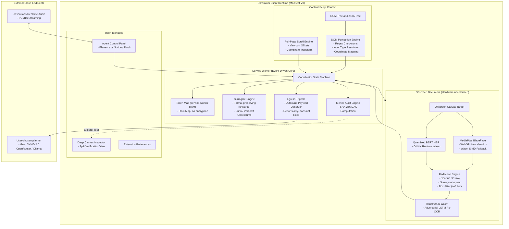
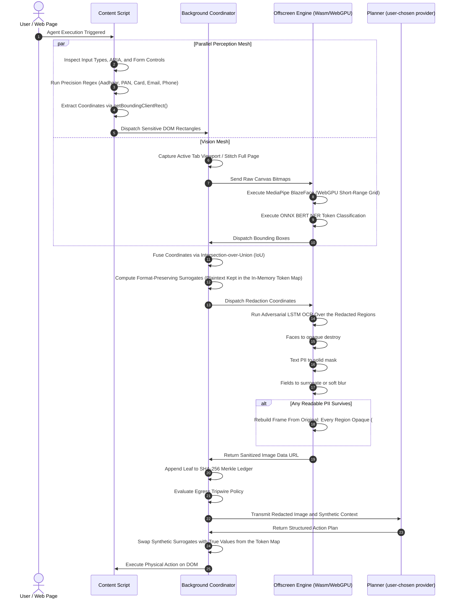
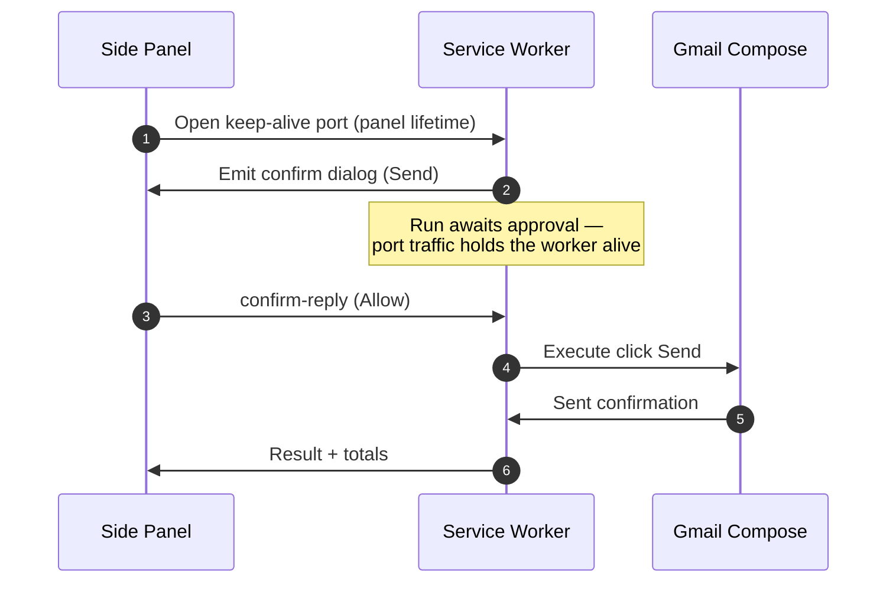
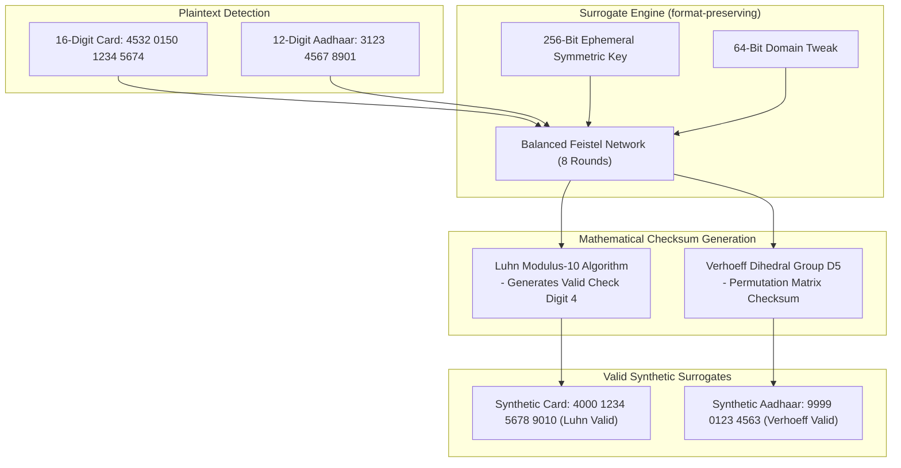
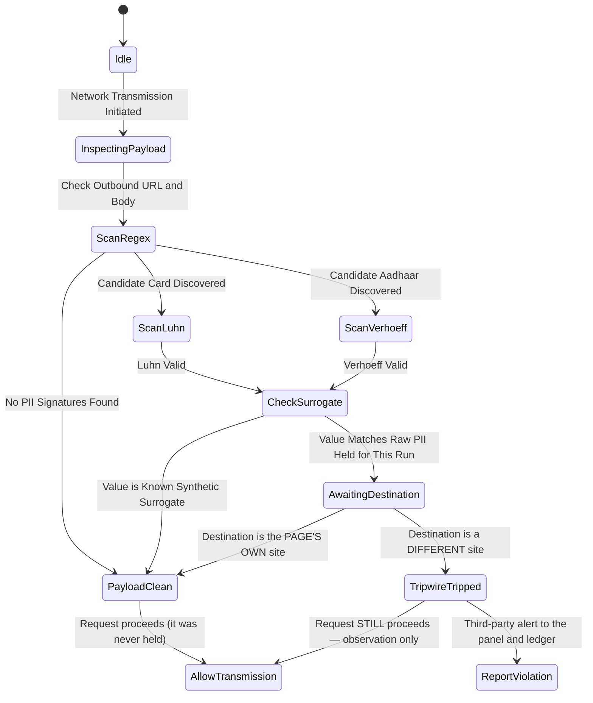

# PRY: On-Device Visual Perception and Privacy-Preserving Browser Agent

PRY is an autonomous, client-side browser agent engineered for Chromium Manifest V3. It intercepts, sanitizes, and cryptographically certifies the redaction of personally identifiable information (PII) before any visual or textual state is transmitted to external multimodal inference endpoints, remote planners, or third-party web trackers.

Developed for Smart India Hackathon 2026, Problem Statement 26171: *On-Device Visual Perception for Lightweight Browser Agents*.

---

## Table of Contents

- [1. Executive Summary](#1-executive-summary)
- [2. Problem Statement and Threat Model](#2-problem-statement-and-threat-model)
  - [2.1 The Multimodal Screen Leakage Vulnerability](#21-the-multimodal-screen-leakage-vulnerability)
  - [2.2 Threat Vectors Addressed](#22-threat-vectors-addressed)
  - [2.3 Regulatory Non-Compliance Risks](#23-regulatory-non-compliance-risks)
- [3. System Architecture and Process Isolation](#3-system-architecture-and-process-isolation)
  - [3.1 Manifest V3 Architectural Topology](#31-manifest-v3-architectural-topology)
  - [3.2 Component Process Boundaries](#32-component-process-boundaries)
- [4. Dual-Mesh Perception Engine](#4-dual-mesh-perception-engine)
  - [4.1 Mesh 1: Deterministic DOM Analysis](#41-mesh-1-deterministic-dom-analysis)
  - [4.2 Mesh 2: Accelerated Pixel-Level Computer Vision](#42-mesh-2-accelerated-pixel-level-computer-vision)
  - [4.3 Mesh Fusion and Coordinate Spatial Alignment](#43-mesh-fusion-and-coordinate-spatial-alignment)
- [5. Machine Learning Models and Runtime Specifications](#5-machine-learning-models-and-runtime-specifications)
  - [5.1 MediaPipe BlazeFace Short-Range TFLite](#51-mediapipe-blazeface-short-range-tflite)
  - [5.2 Quantized BERT Token Classification (ONNX Runtime Web)](#52-quantized-bert-token-classification-onnx-runtime-web)
  - [5.3 Tesseract.js WebAssembly LSTM Engine (Adversarial Auditor)](#53-tesseractjs-webassembly-lstm-engine-adversarial-auditor)
  - [5.4 ElevenLabs Scribe Realtime and Flash v2.5](#54-elevenlabs-scribe-realtime-and-flash-v25)
  - [5.5 Planner (multi-provider: remote or fully local)](#55-planner-multi-provider-remote-or-fully-local)
  - [5.6 Architectural Assessment: GLiNER Model Integration](#56-architectural-assessment-gliner-model-integration)
  - [5.7 Experience replay without content bleed](#57-experience-replay-without-content-bleed)
- [6. Mathematical and Cryptographic Specifications](#6-mathematical-and-cryptographic-specifications)
  - [6.1 Format-Preserving Surrogate Generation (hash-derived, not FF3-1)](#61-format-preserving-surrogate-generation-hash-derived-not-ff3-1)
  - [6.2 Mathematical Checksum Verification (Luhn and Verhoeff Algorithms)](#62-mathematical-checksum-verification-luhn-and-verhoeff-algorithms)
  - [6.3 Visual Redaction Tiers and the Reversibility Test](#63-visual-redaction-tiers-and-the-reversibility-test)
  - [6.4 Immutable Merkle Directed Acyclic Graph (DAG) Ledger](#64-immutable-merkle-directed-acyclic-graph-dag-ledger)
  - [6.5 Detection Coverage and Known Gaps](#65-detection-coverage-and-known-gaps)
- [7. Outbound Egress Tripwire and Security Invariants](#7-outbound-egress-tripwire-and-security-invariants)
  - [7.1 Observational Egress Monitoring (not interception)](#71-observational-egress-monitoring-not-interception)
  - [7.2 Ephemeral Secret Vault Management](#72-ephemeral-secret-vault-management)
- [8. Deep Canvas Inspector and Visual Verification](#8-deep-canvas-inspector-and-visual-verification)
- [9. Comparative Analysis: PRY vs. RAIDX Agent](#9-comparative-analysis-pry-vs-raidx-agent)
- [10. Repository Structure](#10-repository-structure)
- [11. Installation, Verification, and Build Pipeline](#11-installation-verification-and-build-pipeline)
  - [11.1 Prerequisites](#111-prerequisites)
  - [11.2 Verification Test Suite](#112-verification-test-suite)
  - [11.3 Production Build Process](#113-production-build-process)
  - [11.4 Latency Benchmark](#114-latency-benchmark)
  - [11.5 Demo Fixtures](#115-demo-fixtures)
  - [11.6 Browser Deployment](#116-browser-deployment)
  - [11.7 Packaged build (release artifact)](#117-packaged-build-release-artifact)
- [12. Regulatory and Compliance Alignment](#12-regulatory-and-compliance-alignment)
- [13. License](#13-license)

---

## 1. Executive Summary

Standard agent architectures capture viewports and send raw DOM trees to cloud models — exposing confidential user data. PRY establishes a local security boundary: an on-device perception engine (DOM heuristics plus neural computer vision over WebGPU/WebAssembly SIMD) redacts before anything leaves.

Key capabilities:
- Client-side redaction of faces, government IDs, credentials, and payment records — faces destroyed with an opaque fill, never a recoverable blur, across three local channels (BlazeFace over the whole frame and native-resolution tiles, Chrome's shape detector, skin-colour pass). The guarantee is irreversibility of what is detected, not complete detection.
- Format-preserving surrogates: replacements keep length, character classes, and checksum validity (Luhn/Verhoeff), so validation and model reasoning survive the swap. Hash-derived and unkeyed — **not** NIST FF3-1 (see §6.1).
- Adversarial OCR verification of the exact shipped bytes: every redacted region is re-read post-JPEG, and frames that leak are rebuilt fully opaque. Proof covers redacted regions, not undiscovered PII.
- Tamper-evident SHA-256 ledger with exportable Merkle root (`audit-proof.json`).
- Egress tripwire reporting PII-shaped page sends by destination. **Reports; never blocks** (§7.1).

---

## 2. Problem Statement and Threat Model

### 2.1 The Multimodal Screen Leakage Vulnerability
A multimodal agent screenshots the active window, collects the DOM, and ships both over HTTPS to external inference APIs. That payload routinely carries profile photos and video feeds (biometrics), visible Aadhaar/PAN/cards (identity theft, cloud log traces), and session content that may persist in provider telemetry or training pipelines.

### 2.2 Threat Vectors Addressed
- **Threat Vector 1: Cloud Eavesdropping and Provider Breach.** Payloads contain only synthetic surrogates and zero-entropy masks — no original pixel of a redacted region is transmitted, so there is nothing to reconstruct.
- **Threat Vector 2: Super-Resolution De-Blurring.** Gaussian blur and pixelation are recoverable (super-resolution, deconvolution). PRY never blurs biometric identifiers: faces are opaquely destroyed, and any soft-tier region the OCR auditor can still read is escalated to opaque before shipping.
- **Threat Vector 3: Broken Reasoning via Brittle Masking.** `[REDACTED]` breaks form validation and confuses models. PRY substitutes synthetically valid, format-preserving numbers.
- **Threat Vector 4: Unverifiable Compliance.** PRY outputs an immutable, verifiable Merkle audit DAG instead of server-side text logs.

### 2.3 Regulatory Non-Compliance Risks
- **India DPDP Act 2023 (Section 6):** purpose limitation and protection of biometric and identification numbers.
- **GDPR Article 9 and Article 25:** no unauthorized processing of special-category data; protection by design and default.
- **HIPAA Privacy Rule (45 CFR Part 160/164):** safeguarding PHI within browser sessions.

---

## 3. System Architecture and Process Isolation

PRY conforms strictly to the Google Chromium Manifest V3 security model, partitioning execution across isolated contexts:



### 3.1 Manifest V3 Architectural Topology
- **Content Scripts:** read-only DOM inspection in an Isolated World — page scripts cannot tamper with PRY state.
- **Service Worker:** event-driven coordinator — tab communication, surrogates, in-memory token map, Merkle tree, tripwires.
- **Offscreen Document:** the DOM/Canvas access MV3 denies workers — all vision, convolution and adversarial OCR run here over WebGPU/WebAssembly.

### 3.2 Component Process Boundaries
- No raw image data in persistent storage; bitmaps live in ephemeral offscreen memory, garbage-collected after redaction.
- Token↔value mappings live only in the worker heap: never in `chrome.storage`, cleared on teardown (§7.2). Plain `Map`, unencrypted, unpartitioned.

---

## 4. Dual-Mesh Perception Engine

PRY implements a two-tier perception model combining structural DOM intelligence with computer vision:



### 4.1 Mesh 1: Deterministic DOM Analysis
- **Target:** Form controls, password inputs, text fields, rendered text nodes, and ARIA attributes.
- **Execution:** Content-script regex matching with checksum verification; viewport coordinates via `getBoundingClientRect()`, accounting for transforms, DPR, and scroll.
- **Control names count as findable text.** A search `<input>` has no text node — its name lives in `placeholder`/`aria-label` — so `find_text` once reported "no visible text" for a box field matching found a turn later. It now sweeps placeholders, aria-labels, image alts, tooltips and submit values through the same matcher, labelling hits by source (`Search [placeholder]`) so the planner reaches for `type_text`.
- **Email addresses commit exactly.** A correct address still reached the wrong contact: synthetic Enter landed on a highlighted non-matching suggestion, and Gmail took it. `typeInto` now clicks an offered suggestion only when it carries exactly the typed address, dismisses anything else with Escape first, commits with Tab, and verifies the address in the compose dialog — reporting "verify the To field" instead of claiming an unproven chip.

### 4.2 Mesh 2: Accelerated Pixel-Level Computer Vision
- **Target:** Rasterized images, canvas elements, profile photos, ID cards, non-selectable text.
- **Execution:** Offscreen MediaPipe BlazeFace plus quantized BERT NER — independent of DOM structure, so obfuscated layouts and SVG text stay protected.

### 4.3 Mesh Fusion and Coordinate Spatial Alignment
The worker reconciles both meshes via IoU, merges overlaps into one envelope box (4-pixel safety margin), and assigns PII classes (`face`, `credit_card`, `aadhaar`, `pan`, `email`, `phone`, `name`).

---

## 5. Machine Learning Models and Runtime Specifications

All perceptual models run locally. Zero perceptual inference data leaves the machine:

### 5.1 MediaPipe BlazeFace Short-Range TFLite
`models/blazeface/face_detection_short_range.tflite` (224 KB, SSD, 128×128 receptive field) via `@mediapipe/tasks-vision` (`delegate: "GPU"`), 4–9 ms per frame on integrated graphics, WebAssembly SIMD fallback when WebGPU is unavailable.

### 5.2 Quantized BERT Token Classification (ONNX Runtime Web)
`models/ner/onnx/model_quantized.onnx` (108 MB, Q8 `dslim/bert-base-NER`) via `@huggingface/transformers` + `onnxruntime-web` WASM SIMD. Finds names/organizations/locations no regex can; inputs bounded at 4,000 chars.

### 5.3 Tesseract.js WebAssembly LSTM Engine (Adversarial Auditor)
Integer-quantized LSTM in WASM that detects **and remediates** weak redactions: each region is cropped from the exact post-JPEG shipped bytes into one strip and re-read (scanning only the pipeline's own crops keeps the check honest). Any legible region rebuilds the whole frame fully opaque (`#000000`), re-encoded and re-verified — only the rebuild ships. Companion pixel check requires faces to come back near-uniformly opaque; a merely "changed" face fails.

### 5.4 ElevenLabs Scribe Realtime and Flash v2.5
- **STT:** 16 kHz mono PCM16 over WebSocket to Scribe. The manifest must declare `audioCapture`, or the device list hides and the failure surfaces as a hardware-sounding `NotFoundError` — the panel names the real cause (permission, device, blocked prompt, held device) via `chrome.runtime.getManifest().permissions`.
- **TTS:** Flash v2.5 narration with a vocal privacy boundary: `voice-core.toSpeakable()` speaks vault tokens as "redacted", flattens markdown, caps length. A token triggers redaction, never refusal (refusing on tokens once silenced every answer quoting one back), and the redaction count is reported.

### 5.5 Planner (multi-provider: remote or fully local)
- **Model:** provider-configurable; shipped default `nvidia/nemotron-3.5-lightning-30b-a3b` via NVIDIA NIM (`src/shared/models.ts`). Groq, OpenRouter, Anthropic, OpenAI and fully-local Ollama resolve through one OpenAI-compatible adapter; per-provider acknowledgement budgets (60 s NVIDIA NIM, 25 s elsewhere) plus fast-model re-routing live in the turn policy below.
- **Operational Role:** consumes sanitized screenshots and synthetic DOM context, outputs structured JSON action plans.
- **Zero-Trust Intent:** enforced policy, not proof — conditional on the detectors in §6.5 firing. Vision is off by default.

#### 5.5.1 Planner turn policy: bounded by silence, not wall clock

A reasoning model visibly progressing must finish, so one turn (`agent.ts`) is bounded by what it *stops doing*:

| Boundary | Budget | What it catches |
| :--- | :--- | :--- |
| First output | 90 s (20 s retry) | No first token. Retried once only when the endpoint proved itself this run; never for an endpoint that said nothing (two 90 s silences measured 180 s dead). Same budget every turn: the prompt grows, and a cold/continuation split landed on the likeliest-to-cut turns. |
| Unacknowledged request | 25 s (60 s NVIDIA NIM) | No response **headers** — stall, queue, overload. The model never saw the prompt, so the turn re-routes to the fast model when one exists; NVIDIA's budget covers its measured 51–64 s queues on ~32 KB requests. Diagnostics print the enforced budget. |
| Mid-turn silence | 30 s | Dropped connection after output started (45 s+ of prior streaming reads as throughput, not retried). |
| Transport drop | — (adapter throws) | Socket died mid-answer; the prompt arrived, so exactly the retryable hiccup. |
| Deliberation | 12 000 reasoning chars or 90 s | Reasoning without converging: steered once, then reported. |
| Degeneration | 4-gram ratio ≥ 0.5, or a 40-word block 3× | Repetition loop (deltas arrive, so silence windows can't see it; measured 100 s live). Cut in seconds, never retried or replayed. |
| Ceiling | 210 s | Absolute bound (under MV3's 5-minute limit). |

Every cut is announced; repetition is checked, not duration; replay history is clamped (1 200 chars). Slow runs are dominated by time-to-first-token, split at response headers per turn: late headers mean provider queue (fix: fast-model switch — two turns past 8 s or one past 20 s, once per run, announced, never writing settings), early headers mean model thinking, no headers mean the request never arrived. Every attempt ends in a copyable diagnostics block (planner, budgets, per-attempt headers/first-token/outcome); transport faults are proven against a real fake HTTP endpoint (`scripts/fixtures/fake-provider.mjs`), since stubs cannot produce "no headers".

#### 5.5.2 The frame pipeline: two waiting policies, one implementation

Capture → redact → verify → attack → record costs 1.2 s (1×) to 6.5 s (6-tile cap). Whether it blocks the next turn depends on one question — **does the planner read the frame?** Vision OFF (default): started, not awaited, joined after the next turn as `[Frame after the previous action]`. Vision ON: awaited, read via the VLM's redacted-frame description. Nothing is lost by deferring (evidence, ledger, totals, leaks all land); turns with no tool result report the line as their own entry; every wait keeps one 15 s budget — wedged captures are announced and abandoned, and after the first overrun later frames stop blocking while still filing evidence. Cold start (~10.5 s) sits inside the OCR timeout; OCR jobs queue one-at-a-time. Per-stage costs print once per over-budget run. Bare-navigation tasks (`open yt`) cost zero turns; self-narrating final answers are refused by a narrow vocabulary guard.

#### 5.5.1 Planner turn policy: how a slow or looping turn is bounded

One turn is bounded by **silence, not wall clock** — a reasoning model visibly progressing must finish:

| Boundary | Budget | What it catches |
| :--- | :--- | :--- |
| First output | 90 s (20 s retry) | No first token. Retried once when the endpoint proved itself this run (a previous turn answered, or headers arrived) — never for an endpoint that said nothing at all (two 90 s silences measured 180 s of dead waiting). Same budget every non-retry turn: the prompt grows, and a cold/continuation split landed exactly on the turns most likely to be cut. |
| Unacknowledged request | 25 s (60 s NVIDIA NIM) | No response **headers** — stall, queue, or overloaded machine. The model never saw the prompt, so the SAME turn re-routes to the provider's fast model when one exists; otherwise the run stops instead of spending the silence budget unacknowledged. NVIDIA's budget covers its measured 51–64 s queues on ~32 KB requests; diagnostics print the enforced budget. |
| Mid-turn silence | 30 s | Dropped connection after output started. Streams that ran 45 s+ first are throughput, not hiccups — not re-sent; shorter gets the one retry. |
| Transport drop | — (adapter throws) | Socket died mid-answer. The prompt reached the model, so this is exactly the retryable hiccup. |
| Deliberation | 12 000 reasoning chars or 90 s | Reasoning without converging. Steered once, then reported. |
| Degeneration | 4-gram ratio ≥ 0.5, or a 40-word block 3× | Repetition loop (deltas keep arriving, so no silence window sees it; measured at 100 s live). Cut in seconds, never retried, never replayed into history. |
| Ceiling | 210 s | Absolute bound per turn (under MV3's 5-minute limit). |

Deliberate properties: the check reads **repetition, not duration**; every cut is **announced with its reason**; assistant replay history is clamped (1 200 chars) so monologues are not re-paid each turn.

**Where the time goes.** Slow runs are dominated by endpoint time-to-first-token, named per turn (`responded in 14s (first token after 11s of that)`). Headers split the blame: late headers mean provider queue (fix: fast-model switch), early headers mean model thinking (fix: nothing), no headers mean the request never arrived. Adapters report all three milestones (`requested`, `headers`, `output` — first byte of any kind, since tool-only turns stream no prose).

A run may switch itself to the provider's fast model (two slow turns past 8 s, or one past 20 s): at most once, never mid-turn, announced, never writing user settings (`Options → Speed up when the provider is queueing` disables it; the fast model plans worse — that trade is stated).

**Stalled runs report timings, not vibes.** Every attempt ends in a copyable diagnostics block: planner and fast model, enforced budgets, per-attempt headers/first-token/outcome plus whether the frame pipeline ran alongside. Transport faults untenable from stubs are proven against `scripts/fixtures/fake-provider.mjs`, a real HTTP endpoint told to queue, stall, drop, or never answer while `agent-frame-audit-test` drives the real loop.

#### 5.5.2 The frame pipeline: two waiting policies, one implementation

Capture → redact → verify → attack → record costs 1.2 s (1× viewport) to 6.5 s (6-tile cap). Whether it blocks the next turn depends on one question — **does the planner read the frame?**

| Vision | Who reads the frame | Policy |
| :--- | :--- | :--- |
| **OFF** (default) | Nobody — output is ledger, audit, totals, leak evidence | Started, **not awaited**: runs alongside the next turn, joined after, labelled `[Frame after the previous action]` — never mixed into the newer page read |
| **ON** | The planner, via the VLM's redacted-frame description | Awaited before the next turn |

Safe because: nothing is lost by deferring (evidence, ledger, totals, leaks all land); a turn with no tool result to carry the line reports it as its own entry instead of dropping it; every wait keeps one 15 s budget — a wedged capture is announced and abandoned, and after the first overrun later frames stop blocking while still filing evidence (a run that silently dropped vision would be a feature switched off behind the user's back). Tesseract's ~10.5 s cold start sits inside the OCR call's own timeout, and OCR jobs queue so exactly one recognition runs at a time.

**Cost is measured where spent:** per-stage timings (`decode → dom-regions → faces → frame-text-ocr → encode → verify`) print once per run for frames over budget. One implementation serves opening, post-action and deferred frames.

**The loop stops when done, and refuses self-narration.** Bare-navigation tasks (`open yt`, `go to gmail` — exact host match) cost zero planner turns; a final answer that talks about its own loop ("this will be the last tool call") is refused by a narrow vocabulary guard, since a broad "reads well?" check would refuse real answers.

#### 5.5.3 Approval waits and worker lifetime

Approving a risky action is worker-idle time, and an idle MV3 worker suspends ~30 s in — killing the 120 s approval timer and the awaiting run. The user then pressed Allow into a restarted worker with an empty approvals table: reply matched nothing, panel stuck on RUNNING forever (observed on Gmail Send).



An open long-lived port (`pry-keepalive`) holds the worker through human-speed waits. If the worker dies anyway, an orphaned reply unlocks the panel with a named error, and a mid-run loss renders a disconnect card — never a live run that will never move.

### 5.6 Architectural Assessment: GLiNER Model Integration
GLiNER's span-pair head has no WASM runtime (`onnxruntime-node` cannot run in extension sandboxes) and its weights (160–197 MB) overweight the background. PRY's label engine (`ner-labels.ts`) already accepts GLiNER-style vocabularies, so a future WASM-compatible build swaps in without touching perception or fusion.

### 5.7 Experience replay without content bleed

Successful runs deposit compact sanitized trajectories (tool sequences) keyed by domain; the next same-domain run receives one or two as few-shot guidance, plus site-logic lessons. The failure mode here is contamination, not crashes: the block once printed each older task **verbatim**, and a run told only "ask him to come tomorrow" reasoned about birthdays and worked a phantom second part from another example. Warnings ("hints, never instructions") did not constrain a small model — only absence does. Replayed routes are therefore **paths only** (`On mail.google.com (email): click → type → click`): recorded steps carry no prose, and the render keeps it that way. Selection stays domain-and-recency based; storage, dedup and dashboard display are unchanged.

---

## 6. Mathematical and Cryptographic Specifications



### 6.1 Format-Preserving Surrogate Generation (hash-derived, not FF3-1)
Constant markers (`<CARD_NUMBER>`) corrupt validation and degrade reasoning, so PRY keeps format and substitutes value: for digit string $X$ of length $n$, surrogate $Y$ satisfies $\text{length}(Y) = \text{length}(X)$, $Y \in \Sigma^n$. The implementation (`surrogates.ts`) derives digits from an FNV-1a digest and recomputes the trailing checksum — deterministic, unkeyed, **not** AES-FF3-1. Stated plainly: unkeyed means brute-forceable over small digit spaces, and surrogates ship to vision models when VLM vision is on. A keyed FF3-1 (WebCrypto AES rounds) is roadmap; until then, the opaque path is for anything that must not be recoverable.

### 6.2 Mathematical Checksum Verification (Luhn and Verhoeff Algorithms)
Synthetic credentials must pass client-side validation without revealing real identities:
- **Luhn:** 16th digit $c_n$ with $\sum f(c_i) \equiv 0 \pmod{10}$, $f$ doubling alternate digits from the right (minus 9 over 9).
- **Verhoeff:** Aadhaar's 12th digit from dihedral group $D_5$ tables ($d$, $p$, $\text{inv}$), UIDAI-compliant.

### 6.3 Visual Redaction Tiers and the Reversibility Test

| Tier | Applied to | Mechanism | Reversible? |
| :--- | :--- | :--- | :--- |
| **Opaque destroy** | Faces; PII spans in page text | Overwritten `#000000` | No |
| **Surrogate inpaint** | Confirmed credential / ID fields | Cleared, repainted checksum-valid synthetic | No — originals discarded, not filtered |
| **Soft box filter** | Generic inputs, credential labels | Sliding-window box average (radius 6, capped 40) | Weak by design; non-identifying regions only |

Notes that matter: the soft tier is two explicit 1-D passes (never `ctx.filter`, which silently no-ops on some Chrome builds); faces are excluded from it; `verifyRegions()` rejects merely-altered faces. Two probes attack the shipped bytes (`redaction-attack.ts`) and either rebuilds everything opaque: **reconstruction** (unsharp-mask residual energy; opaque reads `0.00`, shipped blur `0.05–0.26`, escalate at `0.35` — a coarse guard that reliably catches dead/silent blurs, not marginal weakening) and **face coverage** (detector re-run over shipped pixels; <50% covered counts as uncovered; skin-colour excluded for its false-positive rate). Escalated frames label `ESCALATED + VERIFIED`. Every residual carries its channel (`PIXEL:`, `OCR:`, `RECONSTRUCTION:`, `FACE COVERAGE:`); leak patterns (must hit zero to ship) stay separate from rebuild reasons. Surrogate regions skip OCR (their synthetics would match the very patterns scanned — ~4 phantom leaks per credential field; failed paints are caught by the pixel check instead). The badge means "everything redacted here is opaque", never "no PII exists" (§6.5).

### 6.4 Immutable Merkle Directed Acyclic Graph (DAG) Ledger
$$L_i = \text{SHA256}(\text{Timestamp} \parallel \text{TabId} \parallel \text{SHA256}(\text{RawImage}) \parallel \text{SHA256}(\text{RedactedImage}) \parallel \text{EntityTypes})$$
$$N_{\text{parent}} = \text{SHA256}(N_{\text{left}} \parallel N_{\text{right}})$$
Root $R$ plus every leaf ships in `audit-proof.json` — auditors recompute in $O(N)$. Per-leaf $O(\log N)$ inclusion proofs are roadmap, not current.

### 6.5 Detection Coverage and Known Gaps

Bounds stated for judges to find, not discover. Every row is a shipped-code limitation:

| Channel | Covers | Known failure modes |
| :--- | :--- | :--- |
| **Regex + checksum matchers** | Emails (even TLD-less), Indian phones, Aadhaar (Verhoeff), PAN, IFSC, SSN, cards (Luhn, bare/spaced, tasks + pages), honorific/cue names, provider API keys (`sk-or-v1-`, `nvapi-`, `gsk_`, `AIza`, `xai-`, `sk-proj-`, OpenAI/Anthropic/GitHub/Slack/AWS/JWT), cue-word secrets (OTP/passwords via one shared matcher serving pixels, page text and tasks) | Unstructured content: bare uncured names (NER's job by design — regexing every capitalised pair would nuke prose and re-blind the planner), street addresses, DOBs, medical terms, balances. Checksum failures are measured false-positive signal, never redacted. |
| **Contextual analysis** | Values in self-labelled sensitive fields | Needs a readable label; icon-only forms uncovered. |
| **On-device NER** | Names, orgs, locations, any casing | 12 spans/page; ~104 MB quantized recall imperfect on rare/non-Latin names; pages beyond snapshot caps (6 000 chars, 80 elements) scored on main content only. |
| **Face channels** (BlazeFace whole-frame + tiles → Chrome detector → skin colour) | Faces down to ~12 px | Channels run inclusively now (an early hit no longer suppresses the rest — that shipped thumbnail grids). Small-face miss is resolution, not threshold (44 px arrives at ~4 px in a 1280×800 whole frame), hence native-resolution 1:1 crops (≤16, 320 px target). Skipped only for single-crop frames and caller-declared stitched captures (the document cannot tell those from tall viewports). |
| **Text-PII pixel boxes** | Rendered text, fields, avatars, detector-valued elements | Capped scan (1.5 s, 8 000 nodes, 200 regions) redacts what it reaches. Below-fold values provably absent from viewport screenshots no longer count as unplaceable leaks (requires a completed walk; never applies to stitched captures); genuinely unlocatable values are reported masked and handed to frame-text triage, which clears the frame only on found-and-destroyed proof. |
| **Images and canvas text** | Text baked into images/canvas/video/PDF via frame-text triage on the already-redacted frame (self-targeting: legible leftovers are by definition uncovered) | Bounded (6 s wall, 6×900 px slices, logged shortfalls); NER-unseen names unmatchable; misreads missed (never reports absence); **Scan Frame Text** off returns this row to nothing. |
| **Region collection failure** | — | Main thread silent in the bounded round trip: text PII unredacted that frame (faces still are), with an explicit warning — never a silent ship. |
| **Task-text tokenization** | Secrets in the request (cards, Aadhaar, emails, keys, OTPs) plus MESSAGE-PAYLOAD names ("email Priya Sharma", "name: …") | Prepositional non-messaging names ride raw ("go to Priya Sharma's profile") — deliberate: an unreadable instruction is a broken one, not a protected one. Names stay tokenized as payloads, redacted in page/DOM channels, NER-detected on screen. |

---

## 7. Outbound Egress Tripwire and Security Invariants



### 7.1 Observational Egress Monitoring (not interception)
The tripwire hooks page `fetch`/`XHR`/`sendBeacon` in the MAIN world, checks bodies and query strings against PII patterns, separates surrogates from raw values, and classifies destination: same registrable domain is same-site (listed, labelled), anything else raises the third-party alarm. The verdict is computed where the origin is visible and crosses via `normalizeTripwireAlert` — a relay that once rebuilt it inline dropped the verdict, and since missing verdicts read as third-party, Gmail's own traffic was once reported as exfiltration. **It never blocks, cancels, delays or rewrites anything** — hooks call through unchanged and fail open (an earlier draft section describing a deny-gateway never existed as code). True blocking needs browser-enforced `declarativeNetRequest`: roadmap. Alerts land in the ledger, one aggregated entry plus a per-request radar log.

### 7.2 Ephemeral Secret Vault Management
- Mappings live in worker RAM only (`tokenizer.ts`), never `chrome.storage`.
- Plain `Map`, unencrypted, unpartitioned per tab — fast enough for per-snapshot use, cleared on teardown. AES-GCM with per-tab partitioning is roadmap; treat live worker memory as the trust boundary.

---

## 8. Deep Canvas Inspector and Visual Verification

Split-view utility (raw vs sanitized canvas, color-coded boxes, live vault mapping for reviewers, `audit-proof.json` export: hash chain, verdict, Merkle root, leaves).

---

## 9. Comparative Analysis: PRY vs. RAIDX Agent

| Evaluation Vector | RAIDX Agent | PRY (This Solution) |
| :--- | :--- | :--- |
| **Architectural Model** | Cloud-centric proxy | Client-side Zero-Trust MV3 extension |
| **Visual Processing** | Raw screenshots to external servers | Captured, inspected, sanitized in client RAM |
| **Face Redaction** | Cloud vision APIs | Local BlazeFace (WebGPU) + skin-colour pass, opaque fill |
| **Surrogate Integrity** | Static `<REDACTED>` masking | Format-preserving, Luhn/Verhoeff-valid (hash-derived; keyed FF3-1 roadmap §6.1) |
| **Accountability** | Ephemeral server logs | Client SHA-256 chain + Merkle root |
| **Adversarial Verification** | Assumes blur is secure | Re-OCR of shipped bytes with opaque rebuild |
| **Voice Pipeline** | HTTP REST audio upload | 16 kHz PCM16 WebSocket, token suppression |
| **Memory Guarantee** | Remote session caching | Worker-memory-only token map, never persisted |
| **Outbound Defense** | LLM prompt instructions | Deterministic tripwire, same-site/third-party split — reports, never blocks (§7.1) |
| **Full-Page Capability** | Single viewport | Scroll-and-stitch with coordinate re-mapping |

---

## 10. Repository Structure

```
pry/
├── manifest.json              # Chromium Manifest V3 configuration
├── build.mjs                  # ESBuild multi-target compilation pipeline
├── package.json               # Package configuration and dependencies
├── tsconfig.json              # TypeScript strict compilation configuration
├── src/
│   ├── background/            # Service worker: agent loop, policy, memory
│   │   ├── service-worker.ts  # Router, run state, capture + redaction path
│   │   ├── agent.ts           # Planner loop, turn budgets, Tier-0 orchestration
│   │   ├── providers/         # NVIDIA NIM, OpenAI, Anthropic, Groq, Ollama adapters
│   │   ├── executor.ts        # Tool dispatch (navigate, click, type, read, extract)
│   │   ├── detector-v2.ts     # Fusion of regex, contextual, NER and ML spans
│   │   ├── tokenizer.ts       # In-memory token map — nothing is persisted
│   │   ├── surrogates.ts      # Format-preserving (hash-derived) + Luhn/Verhoeff generators
│   │   ├── privacy-ledger.ts  # SHA-256 hash chain and Merkle root over audit entries
│   │   ├── reocr-verification.ts # Re-OCR of shipped bytes; escalates to opaque rebuild
│   │   ├── ml-bridge.ts       # Routes model requests into the offscreen document
│   │   ├── tripwire-aggregator.ts # Collects MAIN-world egress events for the ledger
│   │   ├── vision.ts          # Optional VLM caption of the redacted frame (egress-metered)
│   │   ├── wire-log.ts        # Per-turn egress log rendered in the side panel
│   │   └── stitch.ts          # Viewport scroll and stitch coordinator
│   ├── content/               # Webpage runtime interaction layer
│   │   ├── content.ts         # Isolated world bootstrap and listeners
│   │   ├── perceive.ts        # DOM tree inspection, region scan, regex mesh
│   │   ├── act.ts             # Click / type / scroll primitives
│   │   ├── tripwire.ts        # MAIN-world fetch/XHR/WebSocket interceptor
│   │   ├── fullpage.ts        # Window height and scroll calculation
│   │   └── settle.ts          # Post-action DOM stability wait
│   ├── offscreen/             # Isolated WebAssembly / WebGPU environment
│   │   ├── index.html         # Hardware-accelerated canvas context
│   │   ├── offscreen.ts       # Face channels, rasterizer, convolution pipeline
│   │   ├── ocr.ts             # Tesseract.js adversarial verifier
│   │   └── ocr-correct.ts     # Levenshtein OCR text post-processing
│   ├── ml/                    # On-device models, executed off the main thread
│   │   ├── ner.ts             # Token-classification NER (transformers.js / ONNX)
│   │   ├── guard.ts           # Injection-guard loader (no checkpoint bundled — §6.5)
│   │   └── env.ts             # ONNX Runtime and WASM asset paths
│   ├── sidepanel/             # User interaction panel
│   │   ├── index.html         # Agent interface and status dashboard
│   │   ├── sidepanel.ts       # Event rendering, audit view, settings gate
│   │   ├── voice-controller.ts # Push-to-talk state machine
│   │   ├── scribe-client.ts   # ElevenLabs Scribe STT (single-use token)
│   │   └── tts-client.ts      # ElevenLabs premade-voice TTS
│   ├── inspector/             # Deep inspection utility
│   │   ├── index.html         # Split-canvas visual inspection interface
│   │   └── inspector.ts       # Before/after verification renderer
│   ├── options/               # Settings page: provider, keys, privacy toggles
│   └── shared/                # Pure, headlessly-tested policy and protocol code
│       ├── types.ts           # Protocol message interfaces
│       ├── models.ts          # Model catalogue, thresholds, provider defaults
│       ├── text-pii-patterns.ts # Regex tables for the text channel
│       ├── face-regions.ts    # Face-channel fusion policy
│       ├── region-mapping.ts  # Region → image coordinate transform
│       └── checksums.ts       # Luhn and Verhoeff validation functions
├── models/                    # Bundled on-device machine learning models
│   ├── blazeface/             # MediaPipe BlazeFace TFLite weights
│   └── ner/                   # Quantized ONNX token classification models
├── scripts/                   # Verification suite + model tooling (see npm run verify)
│   ├── verify-pipeline.mjs    # End-to-end assertions over the real shipped modules
│   ├── tripwire-test.mjs      # MAIN-world egress tripwire assertions
│   ├── ocr-test.mjs           # Renders a card, redacts it, asserts OCR cannot recover it
│   ├── eval-ner.mjs           # Runs the bundled NER weights and scores the spans
│   ├── eval-guard.mjs         # Gates any candidate injection-guard checkpoint on recall + FP rate
│   ├── package.mjs            # Builds the distributable zip (upload it as a Release asset)
│   └── fetch-models.mjs       # Downloads model weights (HF token optional)
└── test/                      # Local fixtures only (test/pages/pii-fixture.html)
    └── pages/                 # Static pages used for manual / OCR testing
```

---

## 11. Installation, Verification, and Build Pipeline

### 11.1 Prerequisites
- Node.js 18.0.0 or higher
- npm 9.0.0 or higher
- Google Chrome 120 or higher (with WebGPU support enabled)

### 11.2 Verification Test Suite
```bash
npm run verify
```
*Expected Output:* **1544 total: 1172 pipeline + 31 tripwire + 11 OCR + 41 egress + 98 offscreen integration + 119 agent-loop + 72 voice** — detection, tokenization, redaction, face fusion, region→image mapping, OCR triage, turn policy, ledger integrity, adversarial attack (thresholds calibrated against PRY's own blur kernel; face re-probe plus escalation), the offscreen pipeline over real pixels, and loop judgement calls (bare-navigation goals, self-narrating answers refused, single-paid frame waits, late-frame stage breakdowns, approvals surviving restarts, wording-free replay, `find_text` control names, exact email commits). OCR runs real Tesseract (word boxes triage can paint, not just compile clean). `offscreen-integration-test` asserts the reported box equals the black in the shipped bytes. `agent-frame-audit-test` drives the **real** `runTask` loop — deferred frame lines, ledger/totals accounting, residual leaks, overlapped pixel work, wedged captures ending the run.

### 11.3 Production Build Process
```bash
npm run build
```
*Output:* 7 bundles in `dist/`: `service-worker.js`, `content.js`, `offscreen/offscreen.js`, `sidepanel.js`, `options.js`, `inspector.js`, `tripwire.js`.

### 11.4 Latency Benchmark
Per-capture cost is local pixel work, measured with the shipped Tesseract stack and real tile geometry (`npm run bench:latency`): OCR per tile, 6-tile cap, PNG encode, first-recognition cold start (compare like with like — cold cache runs several times slower). Face-tiling geometry (calls, crop sizes, model-space scale, sensitivity table) is exact; per-call speed is not measurable in Node (no `OffscreenCanvas`/GPU delegate). Planner-turn cost (`{ system, tools, messages }`, ~24 KB flat per turn via pruning) is measured on the real loop: system prompt 9.9 KB, 15 tool schemas 4.5 KB, ~10 KB conversation — stale reads pruned once fresher ones exist (a run once carried two full page reads every turn).

### 11.5 Demo Fixtures
```bash
npm run demo:serve      # http://127.0.0.1:8787/pii-fixture.html
```
Content scripts skip `file://` without *Allow access to file URLs* — loopback serving removes that failure mode. See `test/pages/README.md`.

### 11.6 Browser Deployment
1. Open `chrome://extensions/`, enable **Developer mode**.
2. **Load unpacked** → select `dist/` (never `src/`); reload after every build (stale bundles cause "my fix isn't there" reports).
3. Toolbar icon or sidepanel to run.

### 11.7 Packaged build (release artifact)
`node scripts/package.mjs` writes `publish/pry-agent-1.0.1.zip` (~125 MB with model weights and wasm runtimes — without them, no NER, face model, or OCR verifier). **Not committed** (over GitHub's 100 MB/file limit); published as a GitHub Release asset behind the landing page download button. Verify by listing entries (80, including `models/ner/onnx/model_quantized.onnx`), not by filename.

---

## 12. Regulatory and Compliance Alignment

Compliant without server-side data processing agreements:
- **DPDP Act 2023 (India), Section 6:** biometrics, IDs and Aadhaar numbers never cross into model training sets.
- **GDPR Article 25 + Article 9:** protection by design/default; no unauthorized special-category processing.
- **Zero-Trust:** deny-by-default egress posture — unverified payloads never exit the client.

---

## 13. License

PRY is licensed under the Apache License, Version 2.0. See [LICENSE](LICENSE) for details.
